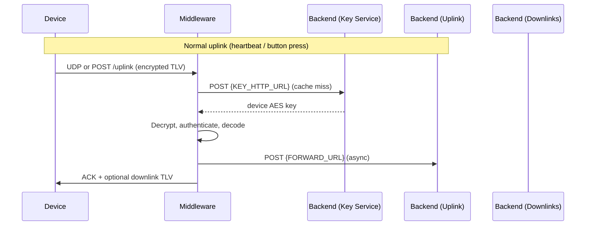
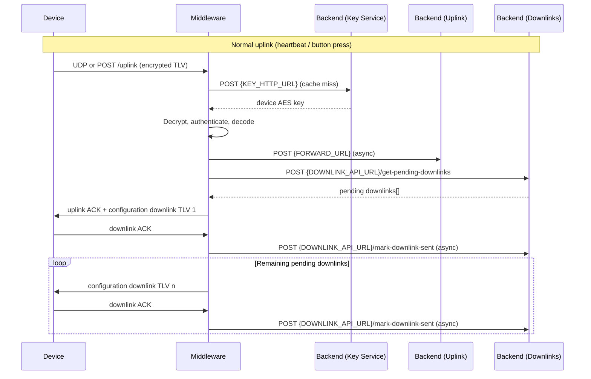
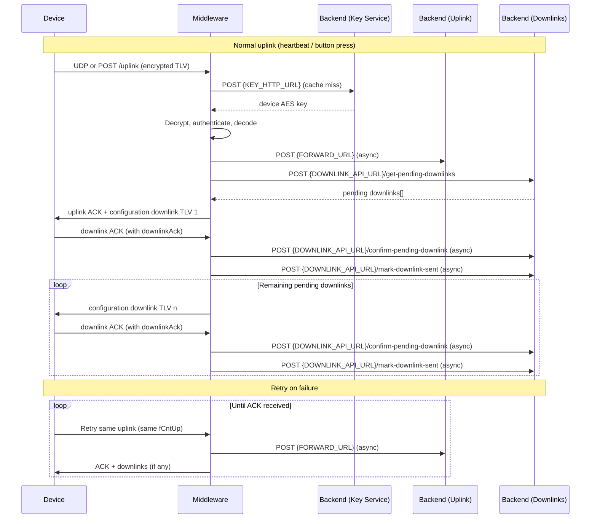

# ioThings Middleware Server - Integrator API Guide

> [!NOTE]
> Specifications are subject to change.

This guide describes the HTTP(S) integration points for this Middleware server.

- Gateway outbound APIs are HTTP(S) calls this Middleware makes to backend systems:
  - your Key Service or the ioThings-provided Key Service
  - your Downlink Service or the ioThings-provided Downlink Service
  - your Backend, to which the Forwarding Service sends received, processed uplinks
- Gateway inbound APIs are endpoints exposed by this Middleware for devices, operators, or test clients (Middleware <> Device). Inbound HTTP is plain HTTP; terminate TLS in front of the Middleware if you need HTTPS.
- Device uplinks and downlinks use TLV payloads. See [tlv-tag-spec.md](tlv-tag-spec.md) and [crypto.md](crypto.md) for the binary format.


## High-level communication sequence

### Uplink

`DOWNLINK_CHECK_ENABLED=false`



### Uplink + config downlinks

`DOWNLINK_CHECK_ENABLED=true`



### Uplink + config downlinks (with retries)

Same as above, plus device uplink retries when the ACK path fails.

`DOWNLINK_CHECK_ENABLED=true`



## Integration Options

There are three main integration options.

### 1. Security - Key Service

The device configuration determines whether secured communication (authenticated encryption) is used. The Middleware supports handling secure and unsecured communication. The Middleware requires knowledge of the device's security key (AES key or public key) to handle secured communication (i.e., decrypt and authenticate the messages). When Middleware receives the first message from a specific device, it obtains the corresponding security key from either of the following Key Services:

1. ioThings-provided Key Service
2. your own Key Service (`KEY_PROVIDER=HTTP`)

Use `KEY_PROVIDER=DB` to load keys from a database, or `KEY_PROVIDER=HTTP` to call an HTTP(S) key endpoint.

The obtained security key is cached and not updated anymore in the Middleware. Changing a device security key after caching requires the Middleware to be restarted.

How to implement your own Key Service is described in Section [HTTP Device Key Lookup](#http-device-key-lookup).


### 2. Forwarding Service

Implement the Forwarding Service to process incoming uplinks from devices.

The Middleware processes received messages in the following order, before sending to your backend:

1. Decryption and authentication, if configured (depending on device configuration)
2. Decode the message (i.e., decode the TLV fields)
3. Forward the decoded message to your backend in JSON format
4. Your backend can then process the message as needed.

The decoded message (JSON) is composed of two types of information:

1. Highly encoded information inside the `0x7E` (`payload`) TLV, requiring the [ioThings uplink decoder](https://docs.iotracker.eu/decoding/uplinks/).
2. Other TLV fields decoded by the Middleware (for example `battery`, `stid`, `fCntUp`), included as JSON fields in the forwarded uplink object.

This integration is used when `FORWARD_URL` is configured. In production, `FORWARD_URL` is required.

See Section [Forward Uplink](#forward-uplink) for an example decoded uplink message as can be expected by your backend server.

### 3. Downlink Service

LTE devices can be reconfigured remotely using so-called configuration downlinks (requires `DOWNLINK_CHECK_ENABLED=true`).

Implement the downlink service when your backend queues messages that need to be sent to devices.

Your backend returns queued downlink messages from `get-pending-downlinks`. The Middleware keeps that array in memory per device and sends entries one at a time in order. After the Middleware sends a downlink to the device, it asynchronously calls `mark-downlink-sent` so your backend knows the message has been transmitted. When the device acknowledges the downlink, the Middleware asynchronously calls `confirm-pending-downlink`.

The `counter` value returned by the downlink API is used in the `0x11` (`fCntDown`) TLV as sent to the device. The device returns that same value in the `0x13` (`downlinkAck`) field when it acknowledges the downlink. The `counter` value must always increase per device and must wrap at `65535`.

Queued downlink arrays are handled ordered by `createdAt` first and then `counter`.

## Conventions

- JSON requests are sent with `content-type: application/json`.
- JSON responses may be empty (`{}`) unless a response schema is specified.
- Outbound HTTP(S) client calls time out after the configured timeout, defaulting to `5000ms`.
- For gateway outbound calls, any non-2xx response is treated as an error.

## Gateway Outbound APIs

These are calls this Middleware makes to external services. Implement these endpoints when the corresponding feature is enabled.

### OAuth Client Credentials Token

Used when pending downlinks are enabled, and also for HTTP key lookup when `KEY_HTTP_USE_DOWNLINK_TOKEN=true`.

Configured by:

- `DOWNLINK_TOKEN_ENDPOINT`
- `DOWNLINK_CLIENT_ID`
- `DOWNLINK_CLIENT_SECRET`

```http
POST {DOWNLINK_TOKEN_ENDPOINT}
content-type: application/x-www-form-urlencoded

grant_type=client_credentials&client_id=lte-server&client_secret=secret
```

#### Expected Response `200 application/json`

```json
{
  "access_token": "eyJhbGciOi...",
  "token_type": "Bearer",
  "expires_in": 3600
}
```

Required response fields:

- `access_token`: string.
- `expires_in`: positive number of seconds.

Optional response fields:

- `token_type`: string. The server defaults to `Bearer` if omitted.

The access token is sent to downlink API calls as `Authorization: Bearer <access_token>`.

### HTTP Device Key Lookup

Used when `KEY_PROVIDER=HTTP`.

Configured by:

- `KEY_HTTP_URL`
- `KEY_HTTP_METHOD`, defaults to `POST`
- `KEY_HTTP_DEVICE_ID_FIELD`, defaults to `deviceId`
- `KEY_HTTP_RESPONSE_KEY_FIELD`, defaults to `key`
- `KEY_HTTP_AUTH_HEADER` and `KEY_HTTP_AUTH_TOKEN`, unless `KEY_HTTP_USE_DOWNLINK_TOKEN=true`

```http
POST {KEY_HTTP_URL}
content-type: application/json
x-api-key: static-token

{
  "deviceId": "00001111",
  "metadata": {
    "version": 1,
    "imei": "123456789012345",
    "iccid": "8944501234567890123",
    "versions": "00000001000000020000000300000004"
  }
}
```

The optional metadata contains the fields available in the plaintext portion of the
uplink when the key is first requested. Binary device fields are sent as uppercase
hexadecimal strings. Because keys are cached by device ID, subsequent uplinks do not
trigger another key request solely to refresh metadata.

If `KEY_HTTP_DEVICE_ID_FIELD=hardwareId`, the body becomes:

```json
{
  "hardwareId": "00001111",
  "metadata": {
    "version": 1,
    "imei": "123456789012345",
    "iccid": "8944501234567890123",
    "versions": "00000001000000020000000300000004"
  }
}
```

If `KEY_HTTP_USE_DOWNLINK_TOKEN=true`, the static auth header is replaced with:

```http
Authorization: Bearer <access_token>
```

#### Expected Response `200 application/json`

```json
{
  "key": "00112233445566778899AABBCCDDEEFF00112233445566778899AABBCCDDEEFF"
}
```

If `KEY_HTTP_RESPONSE_KEY_FIELD=lteAesKey`, the expected response becomes:

```json
{
  "lteAesKey": "00112233445566778899AABBCCDDEEFF00112233445566778899AABBCCDDEEFF"
}
```

The key must be an even-length hexadecimal string. For the default `aes-256-gcm` mode, provide a 32-byte key as 64 hex characters.

Keys are cached in memory by device id for the lifetime of the server process. Restart the server after changing device keys.

### Forward Uplink

Used when `FORWARD_URL` is configured.

Configured by:

- `FORWARD_URL`
- `FORWARD_TIMEOUT_MS`
- `FORWARD_AUTH_HEADER`
- `FORWARD_AUTH_TOKEN`

```http
POST {FORWARD_URL}
content-type: application/json
x-api-key: static-token

{
  "deviceId": "00001111",
  "payload": "01010102046610524E1A0400001111100400000039",
  "uplink": {
    "version": 1,
    "isConfirmed": true,
    "stid": "00001111",
    "fCntUp": 57,
    "payload": "01020304",
    "battery": 88
  },
  "receivedAt": "2026-06-05T12:00:00.000Z",
  "transport": "http"
}
```

Request fields:

- `deviceId`: identifier extracted from `stid`, `deviceId`, or `imei`.
- `payload`: original raw uplink as uppercase hex.
- `uplink`: parsed and decrypted TLV fields. Buffer values are encoded as uppercase hex strings.
- `uplink.payload`: highly encoded device payload from TLV field `0x7E`.
- `receivedAt`: ISO-8601 UTC timestamp from gateway receipt time.
- `transport`: `http` or `udp`.

#### Expected Response

Any 2xx response is accepted. The response body is parsed as JSON when possible, but the parsed value is not used by the gateway.

```json
{
  "accepted": true
}
```

Forwarding runs asynchronously. A forwarding failure is logged but does not prevent the gateway from returning an uplink ACK or accepted response to the device.

### Get Pending Downlinks

Used when `DOWNLINK_CHECK_ENABLED=true`, an uplink has `isConfirmed=true` without a `downlinkAck` field, and the gateway has no locally queued downlinks for that device.

Configured by:

- `DOWNLINK_API_URL`
- `DOWNLINK_CHECK_TIMEOUT_MS`
- `DOWNLINK_UUID_FIELD`, defaults to `id`
- `DOWNLINK_ITEM_PAYLOAD_FIELD`, defaults to `payload`
- `DOWNLINK_COUNTER_FIELD`, defaults to `counter`
- `DOWNLINK_CREATED_AT_FIELD`, defaults to `createdAt`

The endpoint path is resolved relative to `DOWNLINK_API_URL`.

```http
POST {DOWNLINK_API_URL}/get-pending-downlinks
content-type: application/json
Authorization: Bearer <access_token>

{
  "deviceId": "00001111",
  "metadata": {
    "version": 1,
    "imei": "123456789012345",
    "battery": 88,
    "clickType": "single"
  }
}
```

Metadata may include only fields present in the uplink.

#### Expected Response With Pending Downlinks `200 application/json`

```json
[
  {
    "id": "downlink-1",
    "createdAt": "2024-04-05T11:00:00.000Z",
    "counter": 235,
    "payload": "12230000010502"
  },
  {
    "id": "downlink-2",
    "createdAt": "2024-04-05T12:00:00.000Z",
    "counter": 236,
    "payload": "12230000010602"
  }
]
```

Each array entry uses these fields with default configuration:

- `id`: downlink identifier. Used later in `mark-downlink-sent`.
- `createdAt`: required creation timestamp. Used as the primary ordering key before `counter`.
- `counter`: required `fCntDown` value. This value is sent to the device as `0x11` (`fCntDown`) and returned by the device as `0x13` (`downlinkAck`). It must always increase per device and wrap at `65535`.
- `payload`: queued downlink payload. Hex strings are sent as bytes. Non-hex strings are sent as UTF-8. JSON objects are serialized as UTF-8 JSON.

An empty array means no pending downlinks:

```json
[]
```

Do not return `null`, `{}`, or an empty response body. The gateway expects an array for this endpoint.

Do not omit `createdAt` or `counter` from a non-empty pending downlink entry. The gateway rejects the response when the configured fields are missing or `null`.

### Confirm Acknowledged Downlink

Used when an incoming uplink includes `downlinkAck`. This confirms that the device acknowledged a previous `fCntDown`. The call is asynchronous and does not block the current uplink response. The response must be the updated pending downlink array, using the same entry shape as `get-pending-downlinks`.

```http
POST {DOWNLINK_API_URL}/confirm-pending-downlink
content-type: application/json
Authorization: Bearer <access_token>

{
  "deviceId": "00001111",
  "counter": 235
}
```

#### Expected Response With Updated Pending Downlinks `200 application/json`

```json
[
  {
    "id": "downlink-2",
    "createdAt": "2024-04-05T12:00:00.000Z",
    "counter": 236,
    "payload": "12230000010602"
  }
]
```

#### Expected Empty Response `200 application/json`

```json
[]
```

When the response array is received, it replaces the gateway's local pending downlink queue for the device.

### Reconcile Downlink Retransmits

Used for active UDP retransmits when `DOWNLINK_RETRANSMIT_RECONCILE_INTERVAL_MS` has elapsed. This endpoint lets the backend cancel an already-sent, unacknowledged downlink which is no longer valid. It is separate from `get-pending-downlinks`: a sent downlink may correctly be absent from the pending queue while it should still be retried.

The call is read-only. The gateway sends one active retransmit per request and expects an explicit decision for it. If reconciliation fails, the gateway logs the failure and continues retrying.

```http
POST {DOWNLINK_API_URL}/reconcile-downlink-retransmits
content-type: application/json
Authorization: Bearer <access_token>

{
  "deviceId": "00001111",
  "retransmits": [
    {
      "id": "downlink-1",
      "counter": 235,
      "retriesSent": 12,
      "initialSentAt": "2026-09-25T10:00:00.000Z",
      "lastSentAt": "2026-09-25T10:15:00.000Z"
    }
  ]
}
```

#### Expected Response `200 application/json`

```json
{
  "retransmits": [
    {
      "counter": 235,
      "action": "cancel",
      "reason": "downlink_cancelled"
    }
  ]
}
```

Each returned decision must correspond to exactly one submitted `counter`.

- `action: "continue"`: the gateway retains the retry timer and may send the next retry.
- `action: "cancel"`: the gateway immediately removes the local retry timer for that `counter`; it sends no further retries.
- `reason` is optional and is logged when `action` is `cancel`. The backend may use values such as `downlink_cancelled`, `downlink_superseded`, `device_network_changed`, `delivery_expired`, or `unknown_downlink`.

### Mark Downlink Sent

Used after the gateway has successfully sent a pending downlink to the device. This call is asynchronous and is skipped when the pending downlink does not include an id. The response does not update the gateway's local pending downlink queue.

```http
POST {DOWNLINK_API_URL}/mark-downlink-sent
content-type: application/json
Authorization: Bearer <access_token>

{
  "deviceId": "00001111",
  "downlink": "downlink-1"
}
```

#### Expected Response

Any 2xx JSON response is accepted. The response body is ignored.

```json
{
  "accepted": true
}
```

## Downlink Response Normalization

The gateway accepts pending-downlink array entries with configurable field names. Every non-empty pending-downlink entry must include the configured `createdAt` and `counter` fields. The gateway sorts entries by `createdAt` first and then `counter`.

Default entry shape:

```json
{
  "id": "downlink-1",
  "createdAt": "2024-04-05T11:00:00.000Z",
  "counter": 235,
  "payload": "12230000010502"
}
```

If custom field names are configured, the gateway reads those instead:

```env
DOWNLINK_UUID_FIELD=uuid
DOWNLINK_CREATED_AT_FIELD=created
DOWNLINK_COUNTER_FIELD=fCntDown
DOWNLINK_ITEM_PAYLOAD_FIELD=body
```

```json
{
  "uuid": "downlink-1",
  "created": "2024-04-05T11:00:00.000Z",
  "fCntDown": 235,
  "body": "12230000010502"
}
```

## Gateway Inbound APIs

These are calls made by devices, test clients, or operators to this Middleware.

### Health Check

Checks that the HTTP server is running.

```http
GET /status
```

#### Response `200 application/json`

```json
{
  "status": "ok",
  "version": "0.5.0"
}
```

### Submit HTTP Uplink

Accepts a TLV uplink over HTTP. The path is configured by `HTTP_UPLINK_PATH` and defaults to `/uplink`.

```http
POST /uplink
content-type: text/plain

01010102046610524E1A0400001111100400000039
```

The request body is an even-length hexadecimal TLV payload string.

#### Accepted Response `202 application/json`

Returned when the uplink was handled and no immediate downlink was written to the HTTP response.

```json
{
  "status": "accepted",
  "deviceId": "00001111"
}
```

#### Downlink Response `200 text/plain; charset=utf-8`

Returned when the uplink opens a receive window with `isConfirmed=true` and the server sends a TLV ACK and/or pending downlink immediately in the HTTP response body.

```text
140400000039
```

The body is the downlink TLV bytes encoded as uppercase hex.

#### Error Responses

```json
{
  "error": "Incoming TLV payload must be a Buffer, Uint8Array, ArrayBuffer, or even-length hexadecimal string"
}
```

Status mapping:

- `400`: invalid uplink, invalid TLV, missing device id, key/decryption/format validation failure.
- `502`: upstream HTTP call failed, timed out, or returned a non-2xx response while handling the uplink.
- `404`: wrong path or method.

## Error Handling Expectations For Outbound APIs

For all outbound JSON APIs, the gateway:

- Sends `content-type: application/json`, except OAuth token requests which use `application/x-www-form-urlencoded`.
- Parses response bodies as JSON when possible.
- Wraps non-JSON successful responses as `{ "raw": "..." }` internally.
- Throws on non-2xx responses and includes the HTTP status and response body in logs.
- Throws on request timeout or network failure.

For endpoints on the critical uplink path, such as key lookup and downlink checks, upstream failures can cause `/uplink` to return `502` for HTTP uplinks or log a UDP handling error for UDP uplinks.
